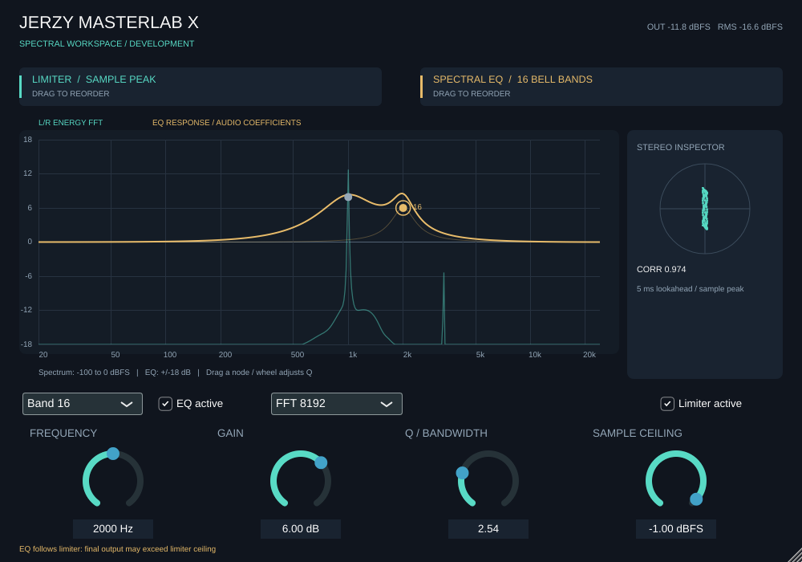
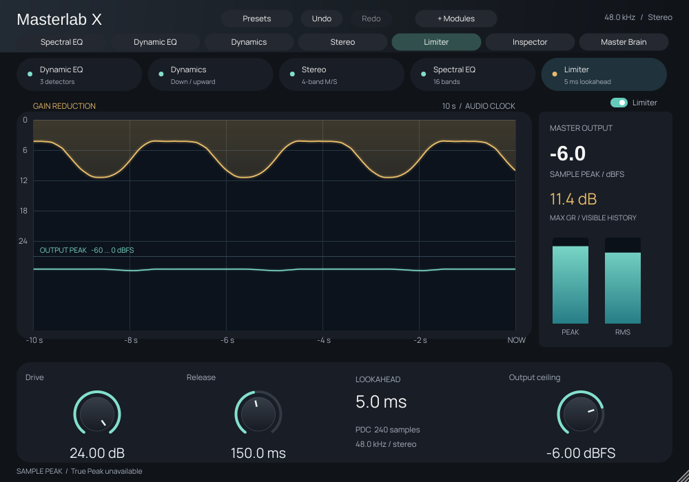

# Jerzy MasterLab X

Rozwojowy fundament Phase A, wersja projektu 0.1.0. Nie jest to ukończone wydanie masteringowe. Wcześniejszy commit b4405d0 miał udany workflow Windows pokazany przez użytkownika; status nowej rewizji należy sprawdzić osobno w Actions. FL Studio nadal nie zostało przetestowane.

Szczegółowe braki produktu i kryteria odbioru: [PRODUCT_AUDIT.md](PRODUCT_AUDIT.md). Analiza materiałów Ozone 12: [OZONE12_REVIEW.md](OZONE12_REVIEW.md).



## Obecnie zaimplementowane

Stereo C++20 DSP niezależny od JUCE: 16 pasm z typami Bell/Low Shelf/High Shelf/High Pass/Low Pass/Notch i niezależnym płynnym bypassem, szereg EQ/limiter lub limiter/EQ, bypass z przejściem 20 ms, stereo-linked sample-peak limiter z opóźnieniem 5 ms i zabezpieczeniem ceiling. Wrapper JUCE 8.0.6: parametry automatyzacji, XML state z walidacją kompletności i zakresów, stałe zgłaszanie latencji, pomiar output peak/RMS/correlation, rzeczywisty FFT 4096–32768 energii L/R i vectorscope, dedykowany edytor EQ z węzłami drag, regulacją Q kółkiem i krzywą z aktualnych współczynników DSP. Kolejność limiter/EQ może podnieść końcowy poziom powyżej ceiling.

Limiter jest wczesnym rozwiązaniem sample-peak z końcowym twardym ograniczeniem, które może zniekształcać. Nie zapewnia True Peak ani kontroli aliasingu. Zmiana kolejności korzysta z 20 ms crossfade dwóch stale aktywnych torów z wyrównaną latencją. Bypass hosta ma osobny, opóźniony tor dry i takie samo płynne przejście. Utrzymywanie obu torów zwiększa CPU. Używaj wyłącznie do prac rozwojowych i odsłuchów kontrolnych.

## Panel limitera

Przycisk **LIMITER** otwiera osobny widok. **Drive** (0–24 dB) podnosi sygnał przetwarzany przez limiter, **Release** (10–1000 ms) steruje powrotem obwiedni, a **Sample Ceiling** ustawia limit próbek. Drive znika po płynnym wyłączeniu modułu. Krótki release i wysoki drive mogą zwiększać zniekształcenia.

Złoty wykres pokazuje maksymalną redukcję obwiedni w każdym oknie 10 ms, do 10 sekund czasu audio. Turkusowy pokazuje peak końcowego wyjścia. Wykresy mają osobne obszary: redukcja 0–24 dB u góry i output -60–0 dBFS poniżej. Podczas przełączania kolejności pokazana obwiednia jest interpolacją obu torów, a nie pomiarem całkowitego tłumienia łańcucha. Przerwy po przepełnieniu kolejki nie są łączone linią. Bez nowego audio historia pozostaje zatrzymana. Historia nie jest zapisywana jako preset.

Stan schema 3 zawiera 86 parametrów. Schema 1 i 2 są migrowane: brakujące ustawienia otrzymują wartości fabryczne (typ Bell, pasmo aktywne; w schema 1 dodatkowo Drive 0 dB i Release 80 ms). Dotychczasowe ID i indeksy parametrów pozostają bez zmian.



## Budowanie

Wymagane CMake >=3.22, C++20; Windows: Visual Studio 2022 Desktop development with C++. CMake pobiera JUCE 8.0.6 z GitHub. JUCE zawiera integrację VST3; osobna instalacja SDK nie jest wymagana.

```sh
cmake -S . -B build -A x64
cmake --build build --config Release --parallel 2
ctest --test-dir build -C Release --output-on-failure
```

Samodzielne testy DSP na Linux/macOS bez JUCE i bibliotek GUI:

```sh
cmake -S . -B build-core -DMASTERLAB_PLUGIN=OFF -DCMAKE_BUILD_TYPE=Release
cmake --build build-core --parallel 2
ctest --test-dir build-core --output-on-failure
```

Linux VST3 wymaga dodatkowo nagłówków ALSA, X11, Xext, Xinerama, Xrandr, Xcursor, FreeType i Fontconfig. Środowisko chmurowe ma je zainstalowane lokalnie w `/workspace/sysroot`, bez zmiany systemowych pakietów. Pełny build Linuksa, CTest, test GUI oraz pluginval level 5 przeszły.

Powtarzalne przygotowanie tej maszyny Debian: `bash scripts/cloud-setup.sh`. Do kolejnych kompilacji uruchom `source scripts/cloud-env.sh`; następnie używaj `$MASTERLAB_CMAKE` i `$MASTERLAB_CTEST`. Test GUI: `bash scripts/gui-smoke.sh`. Walidacja: `bash scripts/gui-smoke.sh --validate`. Ten skrypt sam uruchamia i zatrzymuje wirtualny ekran oraz Openbox. Nie jest potrzebny stale działający serwer aplikacji.

## Instalacja w Windows

Po rzeczywistym udanym CI rozpakuj paczkę i skopiuj cały katalog `JerzyMasterLabX.vst3` do `C:\Program Files\Common Files\VST3`. W FL Studio uruchom Plugin Manager i skanowanie. Testy hosta opisano w FL_STUDIO_TESTS.md; nie zostały wykonane.

## Licencje

Przed dystrybucją wybierz i spełnij odpowiednie warunki JUCE 8 (AGPLv3 lub licencja komercyjna; patrz LICENSE.md w JUCE). Nie nadano licencji własnemu kodowi projektu. Zweryfikuj również warunki SDK VST3 zawartego w przypiętej wersji JUCE, pluginval i notices. Ten projekt nie deklaruje zakończonego audytu licencji ani gotowości do komercyjnej publikacji.

Interfejs Studio: wspólna stylistyka EQ i limitera, podświetlenie aktywnego modułu, wybór widoku kliknięciem karty, większe odczyty i wydzielone karty parametrów. Domyślne okno 1200×800, minimum 750×550. Bary Peak i RMS mierzą dwa różne wskaźniki wyjścia; nie są miernikami kanałów L/R.

Typ filtra wybierasz obok numeru pasma. High Pass i Low Pass mają stałe nachylenie 12 dB/oktawę; Q reguluje rezonans. W HP/LP/Notch gain jest nieużywany. Przycisk Band wyłącza wybrane pasmo płynnym przejściem 20 ms. Charakterystyka uwzględnia aktualne współczynniki i blend każdego pasma.
